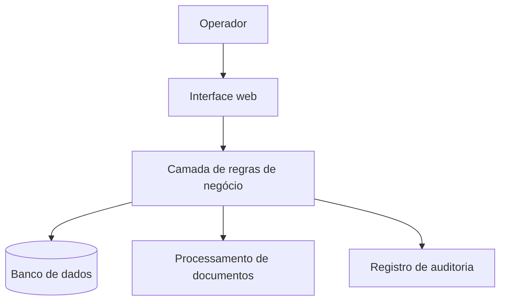

# PINEA — inteligência operacional para licitações

> **Este repositório é uma apresentação pública de um projeto privado.** Ele contém apenas texto e diagramas escritos para este fim. Não há código, dados, configurações nem imagens do sistema original.

Autor: [Danilo Vieira da Silva](https://github.com/DaniloVS22) · Outro projeto: [ORQUESTRA](https://github.com/DaniloVS22/orquestra-case-study)

## O problema

Participar de licitações públicas exige acompanhar muitos editais, prazos, documentos e etapas. Em equipes pequenas isso costuma viver em planilhas, anotações soltas e na memória de quem opera. O resultado é retrabalho, prazos apertados e decisões sem histórico.

## A ideia

A PINEA é um sistema interno que reúne esse ciclo em um só lugar. O objetivo é que o operador decida com dados organizados e não por intuição ou planilha avulsa.

## Visão do produto

## Fluxo operacional (alto nível)

1. **Entrada:** oportunidades são cadastradas ou importadas de fontes públicas.
2. **Leitura dos documentos:** editais em PDF são enviados e o texto é extraído, inclusive de arquivos escaneados.
3. **Organização:** licitações, itens, órgãos, produtos e concorrentes ficam cadastrados com histórico.
4. **Apoio à decisão:** o sistema apresenta informações e sugestões; a decisão final é do operador.
5. **Pós-disputa:** acompanhamento das etapas depois do resultado, até a entrega e o pagamento.
6. **Aprendizado:** análises do que ocorreu alimentam as próximas oportunidades.

## O que o sistema faz

O projeto está em desenvolvimento contínuo e é de uso interno. Esta tabela descreve capacidades de forma conceitual. **Não há métricas de desempenho publicadas**, porque não há medições validadas para divulgar.

| Capacidade | Descrição | Situação desta apresentação |
|---|---|---|
| Cadastro e histórico | Licitações, órgãos, produtos, concorrentes | Implementada no projeto privado |
| Importação de oportunidades | A partir de uma fonte pública | Implementada no projeto privado |
| Leitura de editais em PDF | Extração de texto, com OCR para escaneados | Implementada no projeto privado |
| Painel e alertas de prazo | Visão consolidada e avisos | Implementada no projeto privado |
| Fluxo pós-disputa | Etapas até entrega e pagamento | Implementada no projeto privado |
| Apoio à decisão | Sugestões ao operador | Em evolução; sempre com decisão humana |
| Integrações externas | Conexão com sistemas de terceiros | Não detalhadas aqui |

Esta página não apresenta a PINEA como produto comercial e não afirma que ela envie lances automaticamente.

## Papel da automação e da IA

É importante separar três coisas que se confundem:

- **Automação de processo:** importar, organizar, calcular prazos e avisar. É regra definida, previsível.
- **OCR (reconhecimento óptico de caracteres):** transforma imagem de documento escaneado em texto. É uma técnica clássica de visão computacional. **Não é IA generativa.**
- **Apoio à decisão:** cálculos e sugestões feitos por regras explícitas, sempre revisáveis pelo operador.

Na construção do projeto, usei IA generativa (ChatGPT e Claude Code) como **assistente de desenvolvimento**, e não como parte do que decide dentro do sistema. A evolução do produto prevê explorar IA generativa para resumo e análise de documentos, sempre como apoio e não como decisão.

## Arquitetura e segurança (conceitual)

Princípios adotados, em nível geral:

- Acesso autenticado e separação por perfil de usuário.
- Registro de auditoria das ações relevantes.
- Segredos e configurações fora do código-fonte.
- Ambientes separados para desenvolvimento e operação.
- Testes automatizados como parte do desenvolvimento.
- Decisões de arquitetura registradas por escrito.

Detalhes de infraestrutura, integrações e regras internas não são publicados.

## Aprendizados

**De produto**
- Começar pelo fluxo real do operador. Telas bonitas sem o fluxo certo não resolvem o problema.
- Separar com clareza o que é consolidado do que é experimental.
- Documentar o estado atual do projeto, para não depender de memória.

**De engenharia**
- Dividir o trabalho em fases pequenas, com revisão e testes ao final de cada uma.
- Usar IA para acelerar, mas manter planos, critérios de aceite e auditoria sob controle humano.
- Tratar segurança como requisito desde o início, não como etapa final.

## Visão de futuro e impacto

A PINEA nasceu para resolver problemas reais enfrentados na participação em licitações públicas. A visão de longo prazo é evoluir para uma **plataforma multiempresa**, acessível a pequenas e médias empresas que queiram fornecer produtos e serviços ao governo.

**Hoje**, a PINEA é um sistema privado, de uso interno. **A expansão multiempresa é uma direção planejada**: ela não existe como produto, e a PINEA não atende comercialmente várias empresas.

O que a plataforma pretende facilitar, como objetivo:

- Descoberta de licitações compatíveis com o perfil comercial de cada empresa.
- Análise de preços, produtos, marcas e históricos de contratações públicas.
- Acompanhamento das etapas posteriores à disputa, incluindo empenhos e ordens de compra.
- Orientação sobre requisitos de participação, documentação e pendências.
- Redução de barreiras operacionais para pequenas empresas participarem das compras governamentais.

**Benefício potencial:** para uma empresa pequena, o custo de acompanhar editais, exigências e prazos pode ser um obstáculo à participação. Organizar essas informações em um só lugar pode reduzir esse obstáculo.

**O que não se promete:** a plataforma é apoio à organização e à decisão. Ela não garante regularidade documental, habilitação, vitória nem ausência de desclassificação, e a responsabilidade pela participação continua com a empresa. Não há métricas de impacto nem resultados comerciais divulgados.

## Limites desta apresentação

- Projeto privado, de uso interno, desenvolvido com apoio de IA.
- Nenhum resultado medido é divulgado aqui.
- Dados, clientes, fornecedores, preços e estratégias operacionais não fazem parte deste material.

## Contato

[LinkedIn](https://www.linkedin.com/in/danilo-silva-3303b912b/) · danilovsilva99@gmail.com
